<!-- map: api | sha: 239e023 | sources: server/src/main/java/net/booksnap/**, server/src/main/resources/application*.properties -->

# Map — API

<!-- Generated by /map. Never hand-edit: the next run overwrites everything
     except the Why column, which is carried over verbatim for unchanged
     endpoints. -->

| | |
|---|---|
| **Framework** | Spring Boot 3.4.4 (spring-boot-starter-web, MVC), Java, `pom.xml` |
| **Base path** | `/api/v1` |
| **Derived from** | the nine `@RestController` classes under `server/src/main/java/net/booksnap/domain/**`, plus `config/SecurityConfig.java` for the authorization matrix and the `logout` endpoint. No springdoc/OpenAPI dependency exists, so there is no generated spec to read. |
| **Endpoints** | 33 — 19 GET, 9 POST, 2 PUT, 3 DELETE; plus 2 non-HTTP entry points |
| **Auth model** | Session cookie (`JSESSIONID`, Tomcat in-memory), form-free: `POST /api/v1/auth/login` authenticates by hand through `AuthenticationManager`. Writes additionally require the `X-XSRF-TOKEN` header. Three roles: `user`, `librarian`, `admin`. |

---

## Endpoints

<!-- Sorted by path, then by method. One row per endpoint, no exceptions: a
     complex endpoint points at its handler rather than growing a section.

     Keep cells terse. `Tables` is this map's own discovery — `r` for read,
     `w` for write. `Called from` is transposed from front.Calls by the seam
     pass: leave it empty when generating, and never grep for it yourself. -->

`Handler` paths are relative to `server/src/main/java/net/booksnap/`. `w (trigger)` in
`Tables` means the write is performed by a database trigger, not by application code — see
`Cross-cutting`.

| Method | Path | Auth | Request | Returns | Handler | Tables | Called from | Why |
|---|---|---|---|---|---|---|---|---|
| GET | `/api/v1/auth/csrf` | public | — | `204` (sets `XSRF-TOKEN` cookie) | `domain/auth/api/AuthController.java:101` | — | http.js (the fetch client) | public and session-free on purpose: a browser arriving for the first time holds no token, and the login `POST` is itself refused without one |
| POST | `/api/v1/auth/login` | public | `LoginRequest {email, password}` | `200 AuthenticatedUserResponse`, `401` | `domain/auth/api/AuthController.java:62` | `users` r+w, `auth_identity` r | login-view | the `users` write is `last_login` plus the audit columns, not a business change |
| POST | `/api/v1/auth/logout` | public | — | `204` | `config/SecurityConfig.java:97` | — | booksnap-app | no controller: handled by Spring Security's `LogoutFilter`, declared via `logoutUrl` |
| GET | `/api/v1/auth/me` | `authenticated` | — | `200 AuthenticatedUserResponse` | `domain/auth/api/AuthController.java:107` | — | auth-state | read straight off the session principal, no query |
| POST | `/api/v1/auth/password` | `authenticated` | `ChangePasswordRequest {currentPassword, newPassword}` | `204`, `400` wrong current password or policy violation, `409` no local identity | `domain/auth/api/AuthController.java:130` | `auth_identity` r+w | account-view | acts only on the caller's own account — the DTO has nowhere to put a user id. Also expires the caller's other sessions, after commit |
| GET | `/api/v1/books` | `authenticated` | `page`, `size`, `sort` | `200 PagedResponse<BookResponse>` | `domain/book/api/BookController.java:62` | `book` r, `book_genre` r, `genre` r, `book_author` r, `author` r, `dewey_category` r, `copy` r | catalog-view | |
| POST | `/api/v1/books` | `librarian`, `admin` | `CreateBookRequest` | `201 CreateBookResponse` (QR PNG bytes + ids), `409 BookConflictError`, `400`, `404` unknown Dewey code | `domain/book/api/BookController.java:36` | `book` r+w, `book_genre` w, `book_author` w, `genre` r+w, `author` r+w, `dewey_category` r, `copy` w | create-book-bks | creates the book *and* its first copy in one call; `409` carries the existing `bookId` so the front end can link to it. Unknown genres and authors are inserted on the fly |
| GET | `/api/v1/books/key-stages` | `authenticated` | — | `200 String[]` | `domain/book/api/BookController.java:88` | — | | enum values, no query |
| GET | `/api/v1/books/search` | `authenticated` | `q`, `genres[]`, `copyStatus[]`, `keyStage`, `page`, `size` | `200 PagedResponse<BookResponse>` | `domain/book/api/BookController.java:41` | `book` r, `book_genre` r, `genre` r, `book_author` r, `author` r, `dewey_category` r, `copy` r | SearchController | `q` is ignored below 2 characters |
| DELETE | `/api/v1/books/{bookId}` | `admin` | — | `204`, `404`, `409 ApiError` | `domain/book/api/BookController.java:76` | `book` r+w, `copy` r+w, `borrowing` r, `hold` r | delete-book-modal-bks | soft delete: stamps `deleted_at` on the book and all its copies, so loan history survives. `409` when any copy is on loan or any hold is active. The cover row is deliberately left behind |
| GET | `/api/v1/books/{bookId}` | `authenticated` | `fields` (optional) | `200 BookResponse`, or a reflectively filtered map when `fields` is set, `404` | `domain/book/api/BookController.java:52` | `book` r, `book_genre` r, `genre` r, `book_author` r, `author` r, `dewey_category` r, `copy` r | | declared `Object`: the `fields` branch returns a map, not the DTO |
| PUT | `/api/v1/books/{bookId}` | `librarian`, `admin` | `CreateBookRequest` | `204`, `404` | `domain/book/api/BookController.java:82` | `book` r+w, `book_genre` w, `book_author` w, `genre` r+w, `author` r+w, `dewey_category` r, `cover` r+w | catalog-view, update-book-modal-bks | the `cover` write is the cover following a changed ISBN: moved when no other live book shares the old ISBN, copied otherwise |
| GET | `/api/v1/books/{bookId}/copies` | `authenticated` | — | `200 ListResponse<CopyResponse>`, `404` | `domain/book/api/BookController.java:70` | `book` r, `copy` r, `library` r | book-table-bks | |
| GET | `/api/v1/borrowings` | `librarian`, `admin` | `q`, `status`, `page`, `size`, `sort` (default `endDate`) | `200 PagedResponse<BorrowingResponse>` | `domain/borrowing/api/BorrowingController.java:43` | `borrowing` r, `users` r, `copy` r, `book` r, `book_author` r, `author` r | borrowing-view | staff-only because there is no "my borrowings" endpoint yet: this lists the whole school |
| POST | `/api/v1/borrowings` | `librarian`, `admin` | `CreateBorrowingRequest {userId, copyId}` | `201 CreateBorrowingResponse`, `404`, `409` copy not available | `domain/borrowing/api/BorrowingController.java:33` | `borrowing` w, `copy` r + `copy` w (trigger), `users` r, `hold` r+w | loan-modal-bks | borrowing an `on_hold` copy is allowed only for the student it is held for, and marks that hold `fulfilled` |
| POST | `/api/v1/borrowings/{borrowingId}/return` | `librarian`, `admin` | — | `200 ReturnBorrowingResponse`, `404`, `409` already returned | `domain/borrowing/api/BorrowingController.java:38` | `borrowing` r+w, `copy` r + `copy` w (trigger), `hold` r+w, `book` r, `users` r | return-modal-bks | also promotes the oldest `pending` hold on the book to `active` and reports its id |
| GET | `/api/v1/borrowings/{copyId}` | `librarian`, `admin` | — | `200 GetBorrowingResponse`, `404` | `domain/borrowing/api/BorrowingController.java:51` | `copy` r, `borrowing` r, `users` r, `book` r, `hold` r | catalog-view, scan-qrcode-view | the path variable is a **copy** id, not a borrowing id: the desk scans a copy and asks who is holding it |
| POST | `/api/v1/copies` | `librarian`, `admin` | `CreateCopyRequest` | `201 CreateCopyResponse` (QR PNG bytes + ids), `404` | `domain/copy/api/CopyController.java:36` | `copy` w, `book` r, `book_author` r, `author` r | copy-table-bks, create-book-bks | the author read feeds the identification code (`FIC-ROW`) |
| GET | `/api/v1/copies/statuses` | `authenticated` | — | `200 String[]` | `domain/copy/api/CopyController.java:75` | — | search-bar-bks | enum values, no query |
| DELETE | `/api/v1/copies/{copyId}` | `admin` | — | `204`, `404`, `409 ApiError` | `domain/copy/api/CopyController.java:62` | `copy` r+w, `borrowing` r, `hold` r | delete-copy-modal-bks | soft delete: stamps `deleted_at`. `status` is left alone — it belongs to the triggers, and a later return would overwrite anything set here |
| GET | `/api/v1/copies/{copyId}` | `authenticated` | `fields` (optional) | `200 CopyResponse`, or a filtered map when `fields` is set, `404` | `domain/copy/api/CopyController.java:41` | `copy` r, `book` r, `library` r | | not in the access-rules matrix; follows `GET /books/{id}/copies`, same payload for one copy |
| PUT | `/api/v1/copies/{copyId}` | `librarian`, `admin` | `UpdateCopyRequest {libraryId?, sectionName?, status?}` | `204`, `404` | `domain/copy/api/CopyController.java:68` | `copy` r+w, `book` r, `book_author` r, `author` r | copy-section-modal-bks | the one place application code writes `copy.status` directly — the desk gesture available/damaged → lost |
| GET | `/api/v1/copies/{copyId}/qrcode` | `librarian`, `admin` | — | `200 image/png` (inline, `copy-{id}-qr.png`), `404` | `domain/copy/api/CopyController.java:47` | `copy` r, `book` r, `library` r | copy-qr-modal-bks | ordered before `GET /copies/*` in the matrix so this desk tool stays closed to students |
| POST | `/api/v1/covers` | `librarian`, `admin` | raw image bytes, `isbn` query param, `Content-Type` header | `201`, `400` empty / oversize / non-image | `domain/cover/api/CoverController.java:27` | `cover` r+w | catalog-view, create-book-bks | body is raw bytes, not multipart; max size from `booksnap.cover.max-size-bytes` (2 MiB). An absent `Content-Type` is treated as `image/jpeg` |
| DELETE | `/api/v1/covers/{isbn}` | `librarian`, `admin` | — | `204` (also when absent) | `domain/cover/api/CoverController.java:55` | `cover` r+w | | |
| GET | `/api/v1/covers/{isbn}` | `authenticated` | `If-None-Match` | `200 image/*` with `ETag` + `Cache-Control: no-cache`, `304`, `404` | `domain/cover/api/CoverController.java:34` | `cover` r | CoverController | open to every signed-in user, students included: closing it blanks every thumbnail in the catalogue. Rows imported outside JPA have no timestamp, so no `ETag` |
| GET | `/api/v1/dewey/classes` | `authenticated` | — | `200 DeweyDTO[]` | `domain/dewey/api/DeweyController.java:23` | `dewey_class` r | book-form-bks | |
| GET | `/api/v1/dewey/classes/{classCode}/divisions` | `authenticated` | — | `200 DeweyDTO[]` | `domain/dewey/api/DeweyController.java:28` | `dewey_division` r, `dewey_class` r | book-form-bks | |
| GET | `/api/v1/dewey/divisions/{divisionCode}/categories` | `authenticated` | — | `200 DeweyDTO[]` | `domain/dewey/api/DeweyController.java:33` | `dewey_category` r, `dewey_division` r | book-form-bks | |
| GET | `/api/v1/genres/search` | `authenticated` | `q` (required), `limit` (default 10) | `200 String[]` | `domain/genre/GenreController.java:21` | `genre` r | search-bar-bks | `limit` is applied in the stream, after the whole match set has been fetched |
| GET | `/api/v1/holds` | `librarian`, `admin` | `q`, `status`, `page`, `size`, `sort` (default `createdDate`) | `200 PagedResponse<HoldResponse>` | `domain/hold/api/HoldController.java:43` | `hold` r, `users` r, `book` r, `book_author` r, `author` r, `copy` r | borrowing-view | default `createdDate` sort is the queue order, oldest waiting first |
| POST | `/api/v1/holds` | `authenticated` | `CreateHoldRequest {userId, bookId}` | `201 CreateHoldResponse` (incl. queue position), `404`, `409` book has an available copy or user already queued, `400` book has no copies | `domain/hold/api/HoldController.java:37` | `hold` r+w, `book` r, `users` r, `copy` r, `library` r | hold-modal-bks | open to `user` by design, but the `userId` in the body is still trusted: a student can queue in somebody else's name (access rules §4.3). The `409` exists because an available copy must be borrowed, not reserved — a pending hold would never be promoted |
| GET | `/api/v1/users/search` | `librarian`, `admin` | `q` (required), `limit` (default 10) | `200 UserSearchResponse[]` | `domain/user/api/UserController.java:23` | `users` r | hold-modal-bks, loan-modal-bks | name, surname and email of every active user; the student journey must never call it (access rules §4.4) |

### Non-HTTP entry points

| Method | Path | Auth | Request | Returns | Handler | Tables | Called from | Why |
|---|---|---|---|---|---|---|---|---|
| — | — | non-HTTP | `@Scheduled(cron = "0 5 0 * * *")`, plus once on `ApplicationReadyEvent` | — (logs the row count) | `domain/borrowing/service/OverdueBorrowingScheduler.java:39` | `borrowing` w | — | bulk `@Modifying` JPQL flipping `borrowed` → `overdue` past `end_date`. Bypasses JPA auditing, so it stamps `last_modified_by = "system"` itself. Fires `trg_borrowing_update`, which writes `copy` only on a transition to `returned` — so no `copy` write here |
| — | — | non-HTTP | env: `BOOKSNAP_BOOTSTRAP_ADMIN_EMAIL`, `_PASSWORD`, `_FIRST_NAME`, `_LAST_NAME` | — (throws `IllegalStateException` and stops startup if the password fails `PasswordPolicy`) | `config/AdminBootstrapRunner.java:77` | `users` r+w, `auth_identity` r+w | — | `ApplicationRunner`, guarded on "no account holds the `admin` role" rather than on the account's absence, so it never re-applies the environment password. An existing account with that email is promoted, not duplicated; an existing password is never overwritten |

---

## Cross-cutting

<!-- The conventions a reader needs before they can read a single row above.
     Each one as a fact about this codebase, with the file that implements it. -->

| Concern | How this API does it | Implemented in |
|---|---|---|
| Authentication | Session cookie. `POST /auth/login` calls `AuthenticationManager` by hand, then rotates the session id, registers it and rotates the CSRF token (`CompositeSessionAuthenticationStrategy`), then saves the `SecurityContext` — Spring Security 6 persists nothing on its own on a manual login. Identity ends up as an `AuthenticatedUser` principal; credentials come from `auth_identity` rows with `provider = local` (bcrypt, cost from `booksnap.security.bcrypt-strength`, default 10). Every login rejection carries the same message so unknown email, wrong password, disabled account and missing local identity are indistinguishable. | `config/SecurityConfig.java:264`, `domain/auth/api/AuthController.java:62`, `domain/auth/service/UserDetailsServiceImpl.java:36` |
| Authorization | One URL-based matrix, written as `authorizeHttpRequests` rules rather than `@PreAuthorize`/`@Secured` — there is not a single method-security annotation in the codebase. Every rule names both a method and a path; the chain ends `anyRequest().authenticated()`, so an endpoint added tomorrow is closed until opened on purpose. Roles are `ROLE_USER`/`ROLE_LIBRARIAN`/`ROLE_ADMIN` from the `Role` enum. `/actuator/health` and `/actuator/health/**` are public; the rest of `/actuator/**` is `admin`. **No library scoping yet**: a `librarian` passing a rule may act on every library. `booksnap.security.lockdown-enabled=false` replaces the whole matrix with `permitAll()` and logs a WARN each startup. | `config/SecurityConfig.java:127` |
| Error envelope | `ApiError { timestamp (ISO-8601 LocalDateTime), status (int), message (String), path (request URI) }` as JSON. `BookAlreadyExistsException` answers the one widened shape, `BookConflictError`, which adds `bookId`. Refusals raised inside the filter chain never reach `@ControllerAdvice`, so three components write the same envelope by hand with the Spring `ObjectMapper`: 401 `"Authentication required"`, 403 `"Access denied"` / `"CSRF token missing or invalid"`, 401 `"Session ended: sign in again"`. Unmapped exceptions log in full and answer a fixed `500 "Internal server error"`; an unreadable body answers `400 "Malformed request body"` without quoting it. | `exception/ApiError.java`, `exception/BookConflictError.java`, `exception/GlobalExceptionHandler.java`, `exception/RestAuthenticationEntryPoint.java`, `exception/RestAccessDeniedHandler.java`, `exception/RestExpiredSessionStrategy.java` |
| Validation | Jakarta Bean Validation (`spring-boot-starter-validation`): `@Valid @RequestBody` on the controllers, constraints on the request records, `@Validated` on the controller classes. A failure becomes `400` whose `message` is the field messages joined with `"; "`. Password strength is deliberately *not* an annotation — it lives in `PasswordPolicy` (minimum 12 characters), shared by the change endpoint and the admin bootstrap. | `exception/GlobalExceptionHandler.java:112`, `domain/auth/service/PasswordPolicy.java` |
| Pagination | Spring Data `Pageable` bound from `page`/`size`/`sort`, **1-indexed** (`spring.data.web.pageable.one-indexed-parameters=true`), default size 10. The response is never Spring's `Page`: `PagedResponse<T> { data, page { size, page, totalElements, totalPages } }`, with `page` re-based to 1. Unpaginated collections use `ListResponse<T> { data }`; a few endpoints return a bare JSON array. | `domain/common/dto/PagedResponse.java`, `domain/common/dto/ListResponse.java`, `server/src/main/resources/application.properties:40` |
| Rate limiting | none | — |
| Versioning | `/api/v1` in every `@RequestMapping`; no second version exists and no content negotiation — breaking changes ship in place | — |
| CSRF | Enabled. Token in a script-readable `XSRF-TOKEN` cookie (`CookieCsrfTokenRepository.withHttpOnlyFalse()`), echoed back in the `X-XSRF-TOKEN` header. `SpaCsrfTokenRequestHandler` does two things the defaults do not: it reads a header value as **raw** (the cookie holds the unmasked token) while keeping form parameters masked, and it calls `csrfToken.get()` to force the deferred cookie to actually be written. `GET`/`HEAD`/`OPTIONS`/`TRACE` are exempt by Spring Security itself. | `config/SecurityConfig.java:76`, `config/SpaCsrfTokenRequestHandler.java` |
| CORS | `Customizer.withDefaults()` in the chain; the actual mapping is a `WebMvcConfigurer` driven by `booksnap.cors.allowed-origins` (comma-separated, default `http://localhost:3000`). Empty disables CORS entirely — the normal state in dev (Vite proxy) and in production (`application-production.properties` sets it empty). `allowCredentials(true)`, which makes `*` impossible. Allowed methods: GET, POST, PUT, PATCH, DELETE, OPTIONS. | `config/WebConfiguration.java`, `config/SecurityConfig.java:71` |
| Sessions | Tomcat in-memory, lost on restart and not shared across instances. Cookie `HttpOnly`, `SameSite=Lax`, `Secure` from `SESSION_COOKIE_SECURE` (default false; true in the `production` and `replit` profiles). 8h **idle** timeout. `maximumSessions(-1)` — unlimited, declared purely to put `ConcurrentSessionFilter` in the chain, which is the only thing that acts on a session `SessionInvalidator` has marked expired after a password change. | `config/SecurityConfig.java:87`, `domain/auth/service/SessionInvalidator.java`, `server/src/main/resources/application.properties:96` |
| Auditing | `Auditable` (`@MappedSuperclass`) gives `book`, `copy`, `borrowing`, `hold`, `genre`, `author`, `library`, `users`, `cover`, `auth_identity` their `created_by`/`created_date`/`last_modified_by`/`last_modified_date`. `AuditorAwareImpl` stores the **email address**, explicitly excluding `AnonymousAuthenticationToken` (whose `isAuthenticated()` returns true) and falling back to the literal `"system"`. Bulk `@Modifying` queries bypass the listener entirely and must set the columns themselves. | `domain/Auditable.java`, `config/AuditorAwareImpl.java` |
| `copy.status` is trigger-owned | No endpoint writes `copy.status` through the borrowing or hold path; five triggers defined in `V1__baseline_schema.sql` do (`trg_borrowing_before_insert`, `trg_borrowing_insert`, `trg_borrowing_update`, `trg_hold_insert`, `trg_hold_update`). That is why rows above carry `` `copy` w (trigger) ``: the write is real, it just does not appear in any repository call. The one exception is `PUT /copies/{copyId}`, which sets `status` directly. Service code must `saveAndFlush` then `entityManager.refresh(copy)` to see what a trigger wrote, and flush order decides the final status when several such writes share a transaction. | `server/src/main/resources/db/migration/V1__baseline_schema.sql:860`, `domain/borrowing/service/BorrowingServiceImpl.java:108` |
| Soft delete | `book.deleted_at` and `copy.deleted_at` since `V9`. Nothing filters automatically: every exposed read spells out `deleted_at IS NULL` (`BookRepository`, `CopyRepository`, `BookSpecifications.notDeleted()`). A deleted copy keeps its old `status`, so the filtered read — not the status — is what refuses a loan on it. | `domain/book/repository/BookRepository.java`, `domain/copy/repository/CopyRepository.java`, `domain/book/repository/BookSpecifications.java:26` |
| Profiles | `application.properties` is the base. `application-production.properties` disables Flyway (Replit Publish owns the production diff), empties CORS, forces `Secure` cookies and `server.forward-headers-strategy=framework`. `application-replit.properties` keeps Flyway on with `baseline-on-migrate=false` for a fresh database, and sets the same CORS/cookie/forwarded-header values. Both repoint the datasource at `PG*` environment variables. | `server/src/main/resources/application-production.properties`, `server/src/main/resources/application-replit.properties` |

### Request lifecycle

<!-- The one diagram for this map: the middleware chain a request passes
     through, in order. Capped at ~15 nodes. This is the thing that is most
     expensive to reconstruct by reading code, and the cheapest to draw. -->

```mermaid
flowchart LR
    req[request] --> ctx["SecurityContextHolderFilter<br/>session → SecurityContext"]
    ctx --> cors["CorsFilter<br/>booksnap.cors.allowed-origins"]
    cors --> csrf["CsrfFilter<br/>SpaCsrfTokenRequestHandler"]
    csrf --> logout["LogoutFilter<br/>POST /api/v1/auth/logout → 204"]
    logout --> concurrent["ConcurrentSessionFilter<br/>expired → 401 RestExpiredSessionStrategy"]
    concurrent --> anon[AnonymousAuthenticationFilter]
    anon --> session["SessionManagementFilter<br/>maximumSessions(-1), SessionRegistry"]
    session --> exc["ExceptionTranslationFilter<br/>401 RestAuthenticationEntryPoint<br/>403 RestAccessDeniedHandler"]
    exc --> authz["AuthorizationFilter<br/>the matrix, SecurityConfig.authorize"]
    authz --> mvc["DispatcherServlet<br/>@Valid bean validation"]
    mvc --> ctrl[controller → service → repository]
    ctrl --> errors["GlobalExceptionHandler<br/>ApiError"]
    errors --> res[response]
```

---

## Unreferenced

<!-- Endpoints whose transposed `Called from` came out empty. Omit when none.
     `external` in that column means callers live outside this repo and the
     column proves nothing — such endpoints do not belong in this list. -->

Every consumer of this API lives in this repository, so an empty `Called from` is the
whole story: no shipped code requests these four.

| Endpoint | Observation |
|---|---|
| `GET /api/v1/books/key-stages` | no `Calls` cell in the front map names it, yet `GET /api/v1/books/search` accepts a `keyStage` filter and `search-bar-bks` fetches `/copies/statuses` and `/genres/search` for its two other controls. What is meant to populate the key-stage control? |
| `GET /api/v1/books/{bookId}` | no caller: the front end reads books only through the paged `GET /api/v1/books` and `GET /api/v1/books/search`. Its `fields` branch — the one that answers a filtered map instead of `BookResponse` — has no caller at all. Which screen was a single-book read for? |
| `GET /api/v1/copies/{copyId}` | no caller: copies reach the front end through `GET /api/v1/books/{bookId}/copies`, which returns the same payload for the whole book. Same `fields` branch, same absence of a caller. |
| `DELETE /api/v1/covers/{isbn}` | no caller. `POST /api/v1/covers` (upload) and `GET /api/v1/covers/{isbn}` (read) both have one, and `DELETE /api/v1/books/{bookId}` records that it leaves the cover row behind — so what is expected to remove a cover? |

---

## Gaps

- `Called from` is empty on every row by construction: it is transposed from the front-end map by a later seam pass, never grepped from this side.
- The `Unreferenced` section is omitted: it is derived from that transpose, which has not run yet.
- No endpoint resolved to `?` — every path reaches a repository and an entity whose `@Table(name=…)` is explicit.
- Actuator endpoints (`/actuator/health`, `/actuator/health/**` public; the rest `admin`) have authorization rules in `SecurityConfig.java:141` and `:207` but no handler in this repository, so they get no rows. Their table access is unknown from this codebase.
- `DELETE /api/v1/covers/{isbn}` and `POST /api/v1/covers` are recorded as `` `cover` r+w `` — the `r` is the `existsById`/`findById` the service performs before writing or deleting; the `w` covers both an insert/update and a row removal. This map does not distinguish delete from update.
- `Tables` records the tables Hibernate must touch to satisfy a request, including join tables (`book_genre`, `book_author`) and the eagerly-fetched `@ManyToOne` targets of `Borrowing`, `Hold` and `Copy` (JPA's default fetch for `@ManyToOne` is EAGER and no entity overrides it). It does not attempt to predict which of those become a single join versus a second query.
- `ApiAuthorizationMatrixTest` (28 rows) and `SecurityConfig` agree on every endpoint the test covers; no disagreement was found. The test does not cover `GET /api/v1/auth/me`, `POST /api/v1/auth/password` or `POST /api/v1/auth/logout`, so their `Auth` values above come from `SecurityConfig.java:138` and `:144` alone. The test's `EVERYONE` (all three `Role` values) and the code's `authenticated()` are equivalent only as long as `Role` has exactly those three constants.
- `DeweyController.java` sits in `domain/dewey/api/` but declares `package net.booksnap.domain.dewey;`. Recorded because the `Handler` reference is a path, not a package: the file is where the row says it is.
- `HoldRepository.findByStatusAndCreatedDateBefore` (the 5-week pending-hold expiry of the hold lifecycle) has no caller in `server/src/main/java`, so no endpoint or scheduler row writes that transition.
- The exact SQL a `@Query` produces was read from JPQL, not from a running database — the backend cannot be started from this shell (no Maven on PATH, no `mvnw`).
