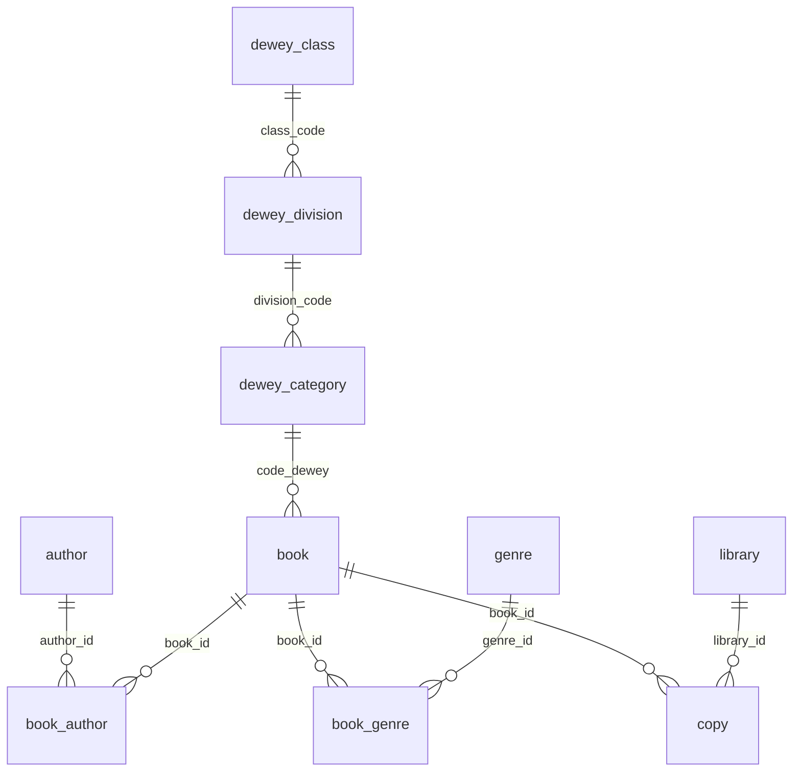
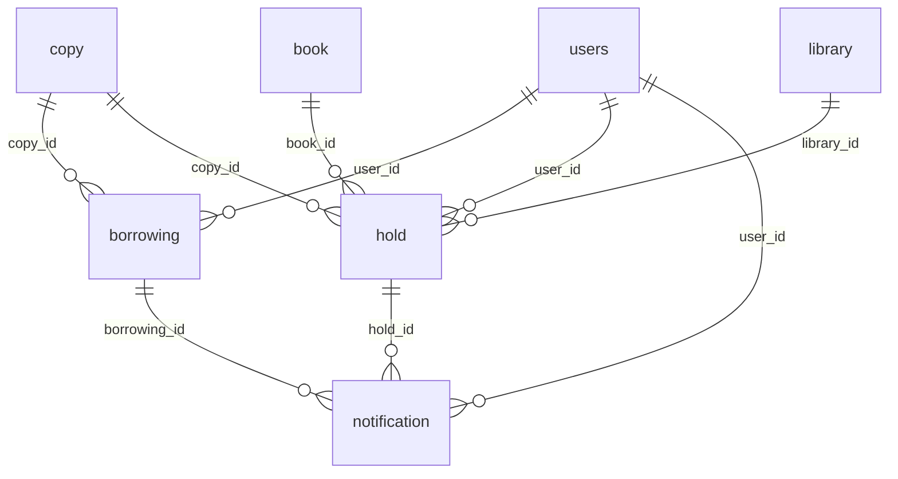
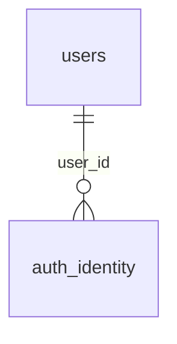

<!-- map: db | sha: 239e023 | sources: server/src/main/resources/db/migration/** -->

# Map — Database

<!-- Generated by /map. Never hand-edit: the next run overwrites everything
     except the Why column, which is carried over verbatim for unchanged
     entities. Knowledge that is not about one entity belongs in your notes,
     not here. -->

| | |
|---|---|
| **Engine** | PostgreSQL 16.14 |
| **Derived from** | schema-only `pg_dump` of the live development database, plus `server/src/main/resources/db/migration/V9__soft_delete_book_and_copy.sql` for the four items V9 adds |
| **Migration tool** | Flyway, `server/src/main/resources/db/migration` (`V<n>__<description>.sql`, V1–V9 present). Latest applied: **V8**. `flyway_schema_history` records a `<< Flyway Baseline >>` at version 2, then 3, 4, 5, 6, 7, 8 — all successful. V9 is pending. |
| **Tables** | 17 |
| **Enums** | 9 |

Extensions in use: `citext`, `pg_trgm`.

---

## Tables at a glance

<!-- Alphabetical. One row per table. Written by / Read by are transposed from
     api.Tables by the seam pass — leave them empty when generating. -->

| Table | Cols | Primary key | Written by | Read by | Why |
|---|---|---|---|---|---|
| `auth_identity` | 9 | `id` | | | one row per login method of a user; `ck_auth_identity_shape` makes `local` and federated identities mutually exclusive shapes |
| `author` | 6 | `id` | | | |
| `book` | 15 | `id` | | | |
| `book_author` | 2 | `author_id`, `book_id` | | | |
| `book_genre` | 2 | `genre_id`, `book_id` | | | |
| `borrowing` | 11 | `id` | | | source of truth for a loan; its triggers are what write `copy.status` |
| `copy` | 11 | `id` | | | |
| `cover` | 7 | `isbn` | | | keyed by ISBN, with no foreign key to `book` |
| `dewey_category` | 3 | `code` | | | reference data loaded by `V2__dewey_reference_data.sql`, never written by the application |
| `dewey_class` | 2 | `code` | | | reference data loaded by `V2__dewey_reference_data.sql`, never written by the application |
| `dewey_division` | 3 | `code` | | | reference data loaded by `V2__dewey_reference_data.sql`, never written by the application |
| `flyway_schema_history` | 10 | `installed_rank` | | | Flyway's own bookkeeping; not part of the domain |
| `genre` | 6 | `id` | | | |
| `hold` | 12 | `id` | | | a hold is placed on a book; `copy_id` stays NULL until a copy is set aside |
| `library` | 6 | `id` | | | |
| `notification` | 6 | `id` | | | |
| `users` | 15 | `id` | | | |

---

## Catalog

<!-- Clustered into Catalog / Lending / Identity; the FK diagram below uses the
     same clustering. Within a cluster, alphabetical. -->

### `author`

| Column | Type | Null | Default | Key | Why |
|---|---|---|---|---|---|
| `id` | `bigint` | no | identity (always) | PK | |
| `name` | `varchar(255)` | yes | — | UQ | the dump reports `varchar(255)`; V4 converts this column to `citext` — see Gaps |
| `created_by` | `varchar(255)` | yes | — | | |
| `created_date` | `timestamptz` | yes | `CURRENT_TIMESTAMP` | | |
| `last_modified_by` | `varchar(255)` | yes | — | | |
| `last_modified_date` | `timestamptz` | yes | `CURRENT_TIMESTAMP` | | |

**Indexes**: `idx_author_name_trgm` — gin on `name` with `gin_trgm_ops`

### `book`

| Column | Type | Null | Default | Key | Why |
|---|---|---|---|---|---|
| `id` | `bigint` | no | identity (always) | PK | |
| `isbn10` | `varchar(10)` | yes | — | | |
| `isbn13` | `varchar(13)` | yes | — | | |
| `title` | `text` | no | — | | |
| `publishing_year` | `smallint` | yes | — | | |
| `publisher` | `text` | yes | — | | |
| `number_of_pages` | `smallint` | yes | — | | NULL spells "unknown"; 0 was `CreateBookRequest`'s primitive `int` default coming back from a JSON null, and V6 both nulled those rows and made 0 unrepresentable |
| `year_recommendation` | `key_stage` | yes | — | | |
| `is_fiction` | `boolean` | no | — | | |
| `code_dewey` | `varchar(255)` | yes | — | FK → `dewey_category.code` ON DELETE NO ACTION | Dewey rows are reference data and are never deleted |
| `created_by` | `varchar(255)` | yes | — | | |
| `created_date` | `timestamptz` | yes | `CURRENT_TIMESTAMP` | | |
| `last_modified_by` | `varchar(255)` | yes | — | | |
| `last_modified_date` | `timestamptz` | yes | `CURRENT_TIMESTAMP` | | |
| `deleted_at` | `timestamptz` | yes | — | | (V9, not yet applied) NULL means live. Deletion became logical because `borrowing` and `hold` reference `copy` with NO ACTION, so a loan returned years ago still refused the delete, and the alternative was erasing loan history. Nothing enforces the filter in the schema — no `@SQLRestriction` on the entity, because the archive views have to read deleted rows |

**Indexes**: `idx_book_isbn10` — btree on `isbn10` with `varchar_pattern_ops`; `idx_book_isbn13` — btree on `isbn13` with `varchar_pattern_ops`; `idx_book_live` — btree on `id`, partial `WHERE deleted_at IS NULL` (V9, not yet applied); `idx_book_title_trgm` — gin on `lower(title)` with `gin_trgm_ops`
**Checks**: `book_pages_positive` — `number_of_pages IS NULL OR number_of_pages > 0`; `non_fiction_requires_dewey` — `is_fiction = false OR code_dewey IS NULL`

### `book_author`

| Column | Type | Null | Default | Key | Why |
|---|---|---|---|---|---|
| `author_id` | `bigint` | no | — | PK, FK → `author.id` ON DELETE CASCADE | |
| `book_id` | `bigint` | no | — | PK, FK → `book.id` ON DELETE CASCADE | |

**Indexes**: none beyond the key

### `book_genre`

| Column | Type | Null | Default | Key | Why |
|---|---|---|---|---|---|
| `genre_id` | `bigint` | no | — | PK, FK → `genre.id` ON DELETE CASCADE | |
| `book_id` | `bigint` | no | — | PK, FK → `book.id` ON DELETE CASCADE | |

**Indexes**: none beyond the key

### `copy`

| Column | Type | Null | Default | Key | Why |
|---|---|---|---|---|---|
| `id` | `bigint` | no | identity (always) | PK | |
| `book_id` | `bigint` | no | — | FK → `book.id` ON DELETE CASCADE | |
| `section_name` | `varchar(255)` | no | — | | |
| `identification_code` | `varchar(255)` | no | — | | |
| `library_id` | `bigint` | no | — | FK → `library.id` ON DELETE NO ACTION | |
| `status` | `copy_status` | no | `'available'` | | trigger-owned: written only by the `borrowing` and `hold` triggers, never by application code or an endpoint. After a write that fires one of them the in-memory entity is stale |
| `created_by` | `varchar(255)` | yes | — | | |
| `created_date` | `timestamptz` | yes | `CURRENT_TIMESTAMP` | | |
| `last_modified_by` | `varchar(255)` | yes | — | | |
| `last_modified_date` | `timestamptz` | yes | `CURRENT_TIMESTAMP` | | |
| `deleted_at` | `timestamptz` | yes | — | | (V9, not yet applied) NULL means live; same logical-deletion reasoning as `book.deleted_at` |

**Indexes**: `idx_copy_book_status` — btree on `(book_id, status)`; `idx_copy_book_status_live` — btree on `(book_id, status)`, partial `WHERE deleted_at IS NULL` (V9, not yet applied)

### `cover`

| Column | Type | Null | Default | Key | Why |
|---|---|---|---|---|---|
| `isbn` | `varchar(13)` | no | — | PK | |
| `image` | `bytea` | no | — | | |
| `content_type` | `text` | no | — | | |
| `created_by` | `varchar(255)` | yes | — | | |
| `created_date` | `timestamptz` | yes | `CURRENT_TIMESTAMP` | | |
| `last_modified_by` | `varchar(255)` | yes | — | | |
| `last_modified_date` | `timestamptz` | yes | `CURRENT_TIMESTAMP` | | |

**Indexes**: none beyond the key

### `dewey_category`

| Column | Type | Null | Default | Key | Why |
|---|---|---|---|---|---|
| `code` | `varchar(255)` | no | — | PK | |
| `name` | `varchar(255)` | no | — | | |
| `division_code` | `varchar(255)` | no | — | FK → `dewey_division.code` ON DELETE NO ACTION | |

**Indexes**: none beyond the key

### `dewey_class`

| Column | Type | Null | Default | Key | Why |
|---|---|---|---|---|---|
| `code` | `varchar(255)` | no | — | PK | |
| `name` | `varchar(255)` | no | — | | |

**Indexes**: none beyond the key

### `dewey_division`

| Column | Type | Null | Default | Key | Why |
|---|---|---|---|---|---|
| `code` | `varchar(255)` | no | — | PK | |
| `name` | `varchar(255)` | no | — | | |
| `class_code` | `varchar(255)` | no | — | FK → `dewey_class.code` ON DELETE NO ACTION | |

**Indexes**: none beyond the key

### `flyway_schema_history`

| Column | Type | Null | Default | Key | Why |
|---|---|---|---|---|---|
| `installed_rank` | `integer` | no | — | PK | |
| `version` | `varchar(50)` | yes | — | | |
| `description` | `varchar(200)` | no | — | | |
| `type` | `varchar(20)` | no | — | | |
| `script` | `varchar(1000)` | no | — | | |
| `checksum` | `integer` | yes | — | | an applied migration's file may never change — Flyway compares this on every startup |
| `installed_by` | `varchar(100)` | no | — | | |
| `installed_on` | `timestamp` | no | `now()` | | |
| `execution_time` | `integer` | no | — | | |
| `success` | `boolean` | no | — | | |

**Indexes**: `flyway_schema_history_s_idx` — btree on `success`

### `genre`

| Column | Type | Null | Default | Key | Why |
|---|---|---|---|---|---|
| `id` | `bigint` | no | identity (always) | PK | |
| `name` | `varchar(255)` | yes | — | UQ | the dump reports `varchar(255)`; V4 converts this column to `citext` — see Gaps |
| `created_by` | `varchar(255)` | yes | — | | |
| `created_date` | `timestamptz` | yes | `CURRENT_TIMESTAMP` | | |
| `last_modified_by` | `varchar(255)` | yes | — | | |
| `last_modified_date` | `timestamptz` | yes | `CURRENT_TIMESTAMP` | | |

**Indexes**: `idx_genre_name` — btree on `name`

### `library`

| Column | Type | Null | Default | Key | Why |
|---|---|---|---|---|---|
| `id` | `bigint` | no | identity (always) | PK | |
| `name` | `varchar(255)` | yes | — | UQ | |
| `created_by` | `varchar(255)` | yes | — | | |
| `created_date` | `timestamptz` | yes | `CURRENT_TIMESTAMP` | | |
| `last_modified_by` | `varchar(255)` | yes | — | | |
| `last_modified_date` | `timestamptz` | yes | `CURRENT_TIMESTAMP` | | |

**Indexes**: none beyond the key

---

## Lending

### `borrowing`

| Column | Type | Null | Default | Key | Why |
|---|---|---|---|---|---|
| `id` | `bigint` | no | identity (always) | PK | |
| `copy_id` | `bigint` | no | — | FK → `copy.id` ON DELETE NO ACTION | a copy cannot be deleted while any loan references it, returned ones included — the constraint V9 answers with logical deletion |
| `user_id` | `bigint` | no | — | FK → `users.id` ON DELETE CASCADE | |
| `status` | `borrowing_status` | no | `'borrowed'` | | |
| `start_date` | `date` | no | — | | |
| `end_date` | `date` | no | — | | |
| `pre_borrow_copy_status` | `copy_status` | yes | — | | captured by `trg_borrowing_before_insert` so that returning a `damaged` copy restores `damaged` instead of `available` |
| `created_by` | `varchar(255)` | yes | — | | |
| `created_date` | `timestamptz` | yes | `CURRENT_TIMESTAMP` | | |
| `last_modified_by` | `varchar(255)` | yes | — | | |
| `last_modified_date` | `timestamptz` | yes | `CURRENT_TIMESTAMP` | | |

**Indexes**: `uq_borrowing_one_active_per_copy` — unique btree on `(copy_id)`, partial `WHERE status IN ('borrowed', 'overdue')`
**Checks**: `borrowing_check` — `start_date <= end_date`
**Triggers**:
- `trg_borrowing_before_insert` — BEFORE INSERT, each row, `fn_capture_copy_status_on_borrowing_insert()`: reads the copy's current `status` into `NEW.pre_borrow_copy_status`.
- `trg_borrowing_insert` — AFTER INSERT, each row, `fn_sync_copy_on_borrowing_insert()`: sets `copy.status = 'borrowed'`.
- `trg_borrowing_update` — AFTER UPDATE, each row, `fn_sync_copy_on_borrowing_update()`: on a transition into `'returned'`, sets `copy.status` to `'damaged'` if `pre_borrow_copy_status` was `'damaged'`, else `'on_hold'` if an `active` hold holds that copy, else `'available'`.

### `hold`

| Column | Type | Null | Default | Key | Why |
|---|---|---|---|---|---|
| `id` | `bigint` | no | identity (always) | PK | |
| `book_id` | `bigint` | no | — | FK → `book.id` ON DELETE NO ACTION | |
| `library_id` | `bigint` | no | — | FK → `library.id` ON DELETE NO ACTION | |
| `copy_id` | `bigint` | yes | — | FK → `copy.id` ON DELETE NO ACTION | NULL while the hold is `pending`: a copy is attached only once one becomes free |
| `user_id` | `bigint` | no | — | FK → `users.id` ON DELETE NO ACTION | |
| `status` | `hold_status` | no | `'pending'` | | |
| `start_date` | `date` | yes | — | | the pickup window, set when the hold is promoted to `active`; unset while `pending` |
| `end_date` | `date` | yes | — | | |
| `created_by` | `varchar(255)` | yes | — | | |
| `created_date` | `timestamptz` | yes | `CURRENT_TIMESTAMP` | | queue order for a book — the oldest `pending` hold wins when a copy comes back |
| `last_modified_by` | `varchar(255)` | yes | — | | |
| `last_modified_date` | `timestamptz` | yes | `CURRENT_TIMESTAMP` | | |

**Indexes**: `idx_hold_pending_queue` — btree on `(book_id, created_date)`, partial `WHERE status = 'pending'`; `uq_hold_one_active_per_user_book` — unique btree on `(user_id, book_id)`, partial `WHERE status IN ('pending', 'active')`
**Checks**: `hold_check` — `start_date IS NULL OR end_date IS NULL OR start_date <= end_date`
**Triggers**:
- `trg_hold_insert` — AFTER INSERT, each row, `fn_sync_copy_on_hold_insert()`: when `copy_id` is set and that copy has no `borrowed`/`overdue` borrowing, sets `copy.status = 'on_hold'`.
- `trg_hold_update` — AFTER UPDATE, each row, `fn_sync_copy_on_hold_update()`: `pending` → `active` with a copy sets `copy.status = 'on_hold'`; `active` → `expired`/`fulfilled` sets it back to `'available'` unless a `borrowed`/`overdue` borrowing exists on that copy.

### `notification`

| Column | Type | Null | Default | Key | Why |
|---|---|---|---|---|---|
| `id` | `bigint` | no | identity (always) | PK | |
| `user_id` | `bigint` | no | — | FK → `users.id` ON DELETE NO ACTION | |
| `hold_id` | `bigint` | yes | — | FK → `hold.id` ON DELETE NO ACTION | a notification hangs off a hold or off a borrowing, so each reference is nullable; nothing in the schema requires exactly one of the two |
| `borrowing_id` | `bigint` | yes | — | FK → `borrowing.id` ON DELETE NO ACTION | |
| `sent_at` | `date` | yes | — | | |
| `type` | `notification_type` | no | — | | |

**Indexes**: none beyond the key

---

## Identity

### `auth_identity`

| Column | Type | Null | Default | Key | Why |
|---|---|---|---|---|---|
| `id` | `bigint` | no | identity (always) | PK | |
| `user_id` | `bigint` | no | — | FK → `users.id` ON DELETE NO ACTION, UQ with `provider` | |
| `provider` | `auth_provider` | no | — | UQ with `user_id`, UQ with `subject` | |
| `subject` | `text` | yes | — | UQ with `provider` | the federated provider's subject identifier; NULL for `local`, where `password_hash` carries the credential instead |
| `password_hash` | `text` | yes | — | | |
| `created_by` | `text` | yes | — | | |
| `created_date` | `timestamptz` | yes | `CURRENT_TIMESTAMP` | | |
| `last_modified_by` | `text` | yes | — | | |
| `last_modified_date` | `timestamptz` | yes | `CURRENT_TIMESTAMP` | | |

**Indexes**: none beyond the keys
**Checks**: `ck_auth_identity_shape` — `(provider = 'local' AND password_hash IS NOT NULL AND subject IS NULL) OR (provider <> 'local' AND subject IS NOT NULL AND password_hash IS NULL)`

### `users`

| Column | Type | Null | Default | Key | Why |
|---|---|---|---|---|---|
| `id` | `bigint` | no | identity (always) | PK | |
| `first_name` | `varchar(255)` | yes | — | | |
| `last_name` | `varchar(255)` | yes | — | | |
| `email` | `email` (domain over `citext`) | no | — | UQ | the login identifier, so the unique index has to reject case variants — `Alice@school.org` must not create a second account next to `alice@school.org`. Lookups also need `stringtype=unspecified` in the JDBC URL, otherwise pgjdbc types the parameter `varchar` and PostgreSQL resolves `citext = varchar` as a case-sensitive `text` comparison |
| `genre` | `text` | yes | — | | |
| `parent_email` | `email` (domain over `citext`) | yes | — | | |
| `key_stage` | `key_stage` | yes | — | | |
| `house` | `text` | yes | — | | |
| `is_active` | `boolean` | yes | `true` | | |
| `last_login` | `timestamp` | yes | — | | the one timestamp column in the schema without a time zone |
| `created_by` | `varchar(255)` | yes | — | | |
| `created_date` | `timestamptz` | yes | `CURRENT_TIMESTAMP` | | |
| `last_modified_by` | `varchar(255)` | yes | — | | |
| `last_modified_date` | `timestamptz` | yes | `CURRENT_TIMESTAMP` | | |
| `role` | `user_role` | no | `'user'` | | added by V7 in place of the unread `is_super` boolean that V8 dropped. The default is the least privileged role, so an account whose role was never spelled out cannot land on a privileged one |

**Indexes**: none beyond the keys

---

## Enums

| Enum | Values | Used by |
|---|---|---|
| `auth_provider` | `local`, `microsoft`, `google` | `auth_identity.provider` |
| `borrowing_status` | `borrowed`, `returned`, `overdue` | `borrowing.status` |
| `copy_status` | `available`, `borrowed`, `on_hold`, `lost`, `damaged`, `removed` | `copy.status`, `borrowing.pre_borrow_copy_status` |
| `hold_status` | `pending`, `active`, `expired`, `fulfilled` | `hold.status` |
| `key_stage` | `pre_school`, `ks_1`, `ks_2`, `ks_3`, `ks_4`, `ks_5` | `book.year_recommendation`, `users.key_stage` |
| `keystage` | `ks_1`, `ks_2`, `ks_3`, `ks_4`, `ks_5`, `pre_school` | no column — duplicate of `key_stage`; V3 drops it, yet it is in the dump (see Gaps) |
| `notification_type` | `overdue_reminder`, `overdue_follow_up`, `hold_ready`, `hold_follow_up`, `hold_expired` | `notification.type` |
| `status` | `available`, `borrowed`, `damaged`, `lost`, `on_hold`, `removed` | no column — duplicate of `copy_status`; V3 drops it, yet it is in the dump (see Gaps) |
| `user_role` | `user`, `librarian`, `admin` | `users.role` |
| `email` (DOMAIN over `citext`, not an enum) | any value matching `email_check`, the domain's address-format regex | `users.email`, `users.parent_email` |

---

## Relationships

<!-- The one diagram for this map: the foreign-key graph. Capped at ~15 nodes —
     past that, draw one cluster per domain, or drop the diagram and keep the
     table above. A hairball is not a map. -->

### Catalog

### Lending

### Identity

---

## Gaps

<!-- Everything this map does not know, and why. Every `?` above appears here.
     A map that claims completeness it does not have is worse than no map. -->

- **The live development database is at V8; V9 is pending.** Everything in this map is read from a schema-only dump of that database, except four items read from `server/src/main/resources/db/migration/V9__soft_delete_book_and_copy.sql`: the columns `book.deleted_at` and `copy.deleted_at`, and the partial indexes `idx_book_live` and `idx_copy_book_status_live`. Each carries the marker `(V9, not yet applied)`. Restarting the backend from the IDE applies V9 and makes the dump and this map agree.
- `author.name` and `genre.name` are reported as `varchar(255)`, which is what the dump says, but `V4__users_email_citext.sql` converts both to `citext` and `flyway_schema_history` records V4 as applied successfully. `users.email` in the same migration *did* land on the `email` domain. The contradiction is unresolved: no live database access was permitted for this run, so the dump is reported as-is. `.claude/CLAUDE.md` asserts these two columns are `citext`.
- The enum types `keystage` and `status`, and the four implicit casts between them and `character varying`, are present in the dump although `V3__drop_orphan_enum_types.sql` drops all six and is recorded as applied. Same cause and same resolution as the item above. The four casts are not otherwise documented in this map.
- `Written by` and `Read by` are empty throughout "Tables at a glance". They are transposed from the API map by a later seam pass, which has not run.
- The `Unreferenced` section is omitted entirely: it is derived from that same transpose.
- `cover` and `flyway_schema_history` are absent from the FK diagrams. Neither has a foreign key in either direction, so they would be isolated nodes.
- `flyway_schema_history` belongs to no business domain. It is listed under Catalog because the clustering is fixed at three, not because it has anything to do with the catalogue.
- Row counts, table sizes and data volumes are not recorded: a schema-only dump contains none.
