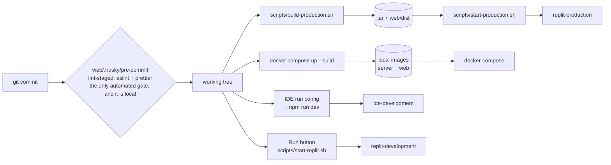

<!-- map: deploy | sha: 239e023 | sources: docker-compose.yml, server/Dockerfile, web/Dockerfile, web/nginx.conf, scripts/**, server/scripts/**, .env.example, .replit, replit*.sh, replit.md, server/src/main/resources/application*.properties, server/pom.xml, web/package.json -->

# Map — Deployment

<!-- Generated by /map. Never hand-edit: the next run overwrites everything
     except the Why column, which is carried over verbatim. -->

| | |
|---|---|
| **CI** | none |
| **Runtime** | local Docker Compose (`docker-compose.yml`, network `booksnap-network`); Replit workspace and a Replit `vm` deployment (`.replit` `[deployment] deploymentTarget = "vm"`) |
| **Registry** | none — compose builds `./server` and `./web` into local images and nothing pushes them; the Replit paths produce `server/target/booksnap-backend-0.0.1-SNAPSHOT.jar` and `web/dist`, not images |
| **Environments** | 4 |
| **Covered here** | **In development the backend is not built or run from the shell: it is started from the IDE.** There is no Maven on PATH and no `mvnw` wrapper in `server/`. The `backend` compose service exists, but day to day only `db` comes from compose. Flyway owns the schema and applies `server/src/main/resources/db/migration/V<n>__*.sql` **at application startup**, which in development means when the IDE starts the backend. This repository holds the compose stack, both Dockerfiles, the nginx config, the three production/Replit scripts and the two development-database scripts. It holds no CI configuration; the Replit Secrets, both managed PostgreSQL instances and the production schema diff are managed outside it. |

---

## Environments

| Env | URL | Deploys from | Trigger | Database | Why |
|---|---|---|---|---|---|
| ide-development | front `http://localhost:5000`, API `http://localhost:8080` | the working tree, uncompiled | human: IDE run configuration for the backend, `npm run dev` in `web/` | `db` compose service — container `booksnap-postgres`, `postgres:16-alpine`, volume `booksnap-db-data`, started with `docker compose up -d db` | Migrations: **yes**, Flyway runs when the IDE starts the backend. No Maven on PATH and no `mvnw` in `server/`, so the shell cannot build or run it. Vite listens on 5000 (`strictPort`) and proxies `/api` and `/actuator/health` to the API, so the front end is same-origin: `CORS_ALLOWED_ORIGINS` and `VITE_API_BASE_URL` are both left empty. spring-dotenv reads `server/.env`, not the root `.env`. |
| docker-compose | front `http://localhost:${FRONTEND_PORT:-3000}` (nginx), API `http://localhost:${BACKEND_PORT:-8080}` | the working tree, built into two local images | human: `docker compose up --build` | the same `db` service, reached as `DB_HOST=db` on `booksnap-network` | Migrations: **yes**, at `backend` container start. Two origins here (front on 3000, API on 8080), so CORS applies: `CORS_ALLOWED_ORIGINS` defaults to `http://localhost:3000`. `SPRING_PROFILES_ACTIVE` defaults to `docker`, for which no properties file exists. |
| replit-development | Replit preview over HTTPS (`$REPLIT_DEV_DOMAIN`); `.replit` maps `localPort = 5000` to `externalPort = 80` | the Replit workspace checkout | human: Run button → workflow `Project` → workflow `Booksnap` → `bash scripts/start-replit.sh`, `waitForPort = 5000` | Replit-managed PostgreSQL 16 (`.replit` module `postgresql-16`), reached through `PGHOST`/`PGPORT`/`PGDATABASE`/`PGUSER`/`PGPASSWORD` | Migrations: **yes** — profile `replit` sets `spring.flyway.baseline-on-migrate=false` so a fresh database runs every migration rather than baselining at V2. `booksnap.cors.allowed-origins` is emptied and the session cookie forced `secure` (the preview is HTTPS). |
| replit-production | ? | the same checkout | Replit Publish: `[deployment] build = bash scripts/build-production.sh`, `run = bash scripts/start-production.sh` | Replit-managed production PostgreSQL, same `PG*` variables | Migrations: **no** — `application-production.properties` sets `spring.flyway.enabled=false` and `replit.md` records that Replit Publish owns the production schema diff. `ddl-auto=validate` still runs, so a schema the diff has not applied fails startup. Sessions are in Tomcat memory, which is why the target is a VM rather than a scaling deployment. |

---

## Pipeline

<!-- The one diagram for this map: commit → CI → artifact → environment.
     Capped at ~15 nodes. Include the gates, because the gates are what people
     forget. -->

Every arrow out of `working tree` is a human running a command: there is no gate
between source and any environment.

---

## Workflows

**CI: none — no CI configuration in this repository.** No `.github/`, no
`.gitlab-ci.yml`, no other pipeline file. The rows below are the scripts and
hooks that stand in for one; all but the last are run by hand or by Replit.

| Workflow | File | Triggers | Does | Secrets used |
|---|---|---|---|---|
| `build-production` | `scripts/build-production.sh` | `.replit` `[deployment] build`, or by hand | `npm ci --prefix web`; `VITE_API_BASE_URL= npm run build --prefix web`; `mvn -B -f server/pom.xml -DskipTests package` | — |
| `start-production` | `scripts/start-production.sh` | `.replit` `[deployment] run` | refuses to start unless the jar and `web/dist/index.html` exist and `PGHOST`, `PGDATABASE`, `PGUSER`, `PGPASSWORD` are all set; exports `SPRING_PROFILES_ACTIVE=production` and `BOOKSNAP_API_ORIGIN`; runs `java -jar` plus `npm run preview -- --host 0.0.0.0 --port 5000 --strictPort`; `wait -n` kills both when either exits | `PGPASSWORD` |
| `start-replit` | `scripts/start-replit.sh` | `.replit` workflow `Booksnap` (Run button) | `npm ci --prefix web` when `web/node_modules` is absent; then `mvn spring-boot:run -Dspring-boot.run.profiles=replit` and `npm run dev` in parallel; `wait -n` stops both together | Replit Secrets: `PG*`, `BOOKSNAP_BOOTSTRAP_ADMIN_*` |
| `replit-start` | `replit-start.sh` | nothing — no file in the repository references it | maps `PG*` onto `DB_HOST`/`DB_PORT`/`POSTGRES_*`, sets `VITE_API_BASE_URL=https://${REPLIT_DEV_DOMAIN}:8080`, runs `mvn -q spring-boot:run` with **no** profile and `npm install && npm run dev -- --host 0.0.0.0 --port 3000` | `PGPASSWORD` |
| `load-dev-fixtures` | `server/scripts/load-dev-fixtures.sh` | by hand: `[--database NAME] [--yes]` | `docker exec` into `booksnap-postgres`, loads `server/sql/seed.sql` then `server/sql/covers.sql`; aborts if table `book` is absent (schema not built yet — start the backend from the IDE) or `dewey_category` is empty; confirms before loading over existing books | — |
| `reset-dev-db` | `server/scripts/reset-dev-db.sh` | by hand: `[--database NAME] [--yes]` | runs `server/sql/reset.sql`, then `TRUNCATE TABLE cover`, then replays `V2__dewey_reference_data.sql`, then reloads `seed.sql` and `covers.sql`; leaves the schema and `flyway_schema_history` untouched | — |
| pre-commit | `web/.husky/pre-commit` | `git commit`, via `husky` installed by `npm run prepare` in `web/` | `./node_modules/.bin/lint-staged` → `eslint --fix` and `prettier --write` on staged `*.js` | — |

**Trap**: never run `server/sql/reset.sql` on its own. It truncates the Dewey
reference tables, and only `V2__dewey_reference_data.sql` populates them — `V2`
is already recorded in `flyway_schema_history`, so Flyway will never replay it
and no non-fiction book can be created afterwards. It also leaves `cover`
populated, which makes a later `covers.sql` fail on `cover_pkey`.
`reset-dev-db.sh` handles both.

---

## Configuration

<!-- Alphabetical by variable. The most valuable table in this map: "where does
     this value come from" is the question that costs the most time to answer by
     hand. Record whether a variable is required and what happens when it is
     missing — a silent default is worth a Why. -->

| Variable | Consumed by | Source | Required | Default | Secret | Why |
|---|---|---|---|---|---|---|
| `ASSUME_YES` | script | shell env; normally set by `--yes`/`-y` in `server/scripts/_lib.sh` | no | `0` | no | |
| `BACKEND_PORT` | compose | root `.env` substitution | no | `8080` | no | host-side port mapping only; the container always listens on 8080 |
| `BOOKSNAP_API_ORIGIN` | web, script | `process.env` read by `web/vite.config.js` at dev/preview server start; exported by `scripts/start-production.sh` | no | `http://127.0.0.1:8080` | no | proxy target for `/api` and `/actuator/health`. Read at server start, not baked into the bundle — unlike `VITE_*`. Absent from `.env.example` and `docker-compose.yml`. |
| `BOOKSNAP_BOOTSTRAP_ADMIN_EMAIL` | server | `.env` via spring-dotenv (`server/pom.xml`, `me.paulschwarz:spring-dotenv:4.0.0`); compose env; Replit Secrets | no | empty | no | There are **two `.env` files and they are not interchangeable**: spring-dotenv loads the `.env` of the backend's working directory, so an IDE-started backend reads `server/.env`, while the root `.env` is what `docker compose` substitutes. Set these where the backend you actually run will read them. |
| `BOOKSNAP_BOOTSTRAP_ADMIN_FIRST_NAME` | server | same as above | no | empty | no | |
| `BOOKSNAP_BOOTSTRAP_ADMIN_LAST_NAME` | server | same as above | no | empty | no | |
| `BOOKSNAP_BOOTSTRAP_ADMIN_PASSWORD` | server | same as above | no | empty | yes | applied by `AdminBootstrapRunner` only while no account holds the `admin` role, and never re-applied afterwards; under 12 characters it stops the backend instead of creating a weak administrator |
| `BOOKSNAP_CONTAINER` | script | shell env, read by `server/scripts/_lib.sh` | no | `booksnap-postgres` | no | not declared in `.env.example` |
| `CORS_ALLOWED_ORIGINS` | server | compose env; `.env` via spring-dotenv | no | `http://localhost:3000` | no | empty is correct whenever one origin serves both — the Vite proxy in development, and the `production`/`replit` profiles, which override `booksnap.cors.allowed-origins=` to empty in their own properties file. `*` is impossible: `allowCredentials(true)` forbids it. |
| `DB_HOST` | server | `.env` via spring-dotenv | no | `localhost` | no | `docker-compose.yml` sets `DB_HOST: db` **literally** for the `backend` service, so the root `.env` value is never substituted; the copy that reaches a running backend is `server/.env` (`localhost` for the IDE) |
| `DB_PORT` | server, compose | `.env` | no | `5432` | no | compose uses it for the `db` host-side mapping only; the `backend` service sets `DB_PORT: 5432` literally |
| `FRONTEND_PORT` | compose | root `.env` substitution | no | `3000` | no | |
| `LANG` | server image | `ENV` in `server/Dockerfile` | no | `en_US.UTF-8` | no | |
| `LANGUAGE` | server image | `ENV` in `server/Dockerfile` | no | `en_US:en` | no | |
| `PGADMIN_DEFAULT_EMAIL` | compose | root `.env` substitution | only to start `pgadmin` | — | no | |
| `PGADMIN_DEFAULT_PASSWORD` | compose | root `.env` substitution | only to start `pgadmin` | — | yes | |
| `PGADMIN_PORT` | compose | root `.env` substitution | no | `5050` | no | |
| `PGDATABASE` | server, script | Replit runtime environment | yes under profiles `production` and `replit` | — | no | no fallback in the properties files: an unset value fails datasource creation. `scripts/start-production.sh` checks for it and exits first. |
| `PGHOST` | server, script | Replit runtime environment | yes under profiles `production` and `replit` | — | no | |
| `PGPASSWORD` | server, script | Replit runtime environment | yes under profiles `production` and `replit` | — | yes | |
| `PGPORT` | server | Replit runtime environment | no | `5432` | no | |
| `PGUSER` | server, script | Replit runtime environment | yes under profiles `production` and `replit` | — | no | |
| `POSTGRES_DB` | server, compose, script | root `.env` for compose; `server/.env` for the IDE backend; exported by `replit-start.sh` from `PGDATABASE` | yes | — | no | no fallback in `spring.datasource.url`; unset, the backend fails to start |
| `POSTGRES_PASSWORD` | server, compose, script | as above, from `PGPASSWORD` | yes | — | yes | |
| `POSTGRES_USER` | server, compose, script | as above, from `PGUSER`; `server/scripts/_lib.sh` reads it back out of the container with `printenv` | yes | — | no | |
| `REPLIT_DEV_DOMAIN` | script | Replit runtime environment, read by `replit-start.sh` | — | — | no | |
| `SECURITY_LOCKDOWN_ENABLED` | server | environment only, read by `application.properties` | no | `true` | no | `false` replaces the whole Spring Security permission matrix with `permitAll()` and logs a WARN at every startup. Not declared in `.env.example` or `docker-compose.yml`; documented in `server/README.md` and `replit.md`. |
| `SESSION_COOKIE_SECURE` | server | compose env; `.env` | no | `false` | no | profiles `production` and `replit` hard-code `server.servlet.session.cookie.secure=true`, so this variable has no effect there |
| `SPRING_PROFILES_ACTIVE` | server, compose | root `.env`/compose env; `scripts/start-production.sh` exports `production`; `scripts/start-replit.sh` passes `replit` via `-Dspring-boot.run.profiles` | no | `docker` (compose) | no | there is no `application-docker.properties` and no `@Profile("docker")` in `server/src/main/java/`, so the compose default names a profile that contributes nothing |
| `TZ` | server image | `ENV` in `server/Dockerfile`, with `/etc/localtime` and `/etc/timezone` written to match | no | `Europe/Madrid` | no | |
| `VITE_API_BASE_URL` | web | Docker **build arg** on the `frontend` service → `ENV` in `web/Dockerfile` → `import.meta.env.VITE_API_BASE_URL` in `web/src/api/api-routes.js` | no | empty in `.env.example`; `http://localhost:8080` as the compose build-arg default | no | **build-time, not runtime**: Vite bakes it into the bundle, so changing it requires rebuilding the front-end image. Empty for `npm run dev` (Vite proxies `/api`, everything same-origin), `http://localhost:8080` for compose, and `scripts/build-production.sh` builds with it explicitly empty. |

**Declared but unused**: none outright — every variable in `.env.example` and
`docker-compose.yml` is read somewhere — with two qualifications. (1) `DB_HOST`
in the **root** `.env` is never substituted: `docker-compose.yml` sets
`DB_HOST: db` literally on the `backend` service, so only `server/.env`'s copy
ever reaches a backend. (2) `SPRING_PROFILES_ACTIVE=docker` names a profile with
no `application-docker.properties` and no `@Profile("docker")` in the Java
sources.

**Read but undeclared**: `ASSUME_YES` (`server/scripts/_lib.sh`);
`BOOKSNAP_API_ORIGIN` (`web/vite.config.js`, exported by
`scripts/start-production.sh`); `BOOKSNAP_CONTAINER`
(`server/scripts/_lib.sh`); `PGDATABASE`, `PGHOST`, `PGPASSWORD`, `PGPORT`,
`PGUSER` (`application-production.properties`,
`application-replit.properties`, `scripts/start-production.sh`,
`replit-start.sh` — supplied by the Replit runtime);
`REPLIT_DEV_DOMAIN` (`replit-start.sh` — Replit runtime);
`SECURITY_LOCKDOWN_ENABLED` (`application.properties`).

---

## Services

<!-- Containers and managed services this system runs on, from compose files or
     the deployment manifests. Omit if the project is a single process. -->

| Service | Image | Ports | Depends on | State | Healthcheck | Why |
|---|---|---|---|---|---|---|
| `db` | `postgres:16-alpine`, container `booksnap-postgres` | `${DB_PORT:-5432}:5432` | — | named volume `booksnap-db-data` → `/var/lib/postgresql/data` | `pg_isready -U ${POSTGRES_USER} -d ${POSTGRES_DB}`, 10s/5s, 5 retries, 10s start period | **No auto-init SQL is mounted, deliberately.** Nothing goes into `/docker-entrypoint-initdb.d/`: Flyway owns the schema and the Dewey reference data, and a mounted `sql/` would build a second, unversioned schema on a fresh volume — racing Flyway, and running before the backend exists, so `seed.sql` would hit tables that do not yet exist. Fixtures are loaded by hand after the backend's first start. |
| `pgadmin` | `dpage/pgadmin4:latest` | `${PGADMIN_PORT:-5050}:80` | `db` (`condition: service_healthy`) | stateless (no volume — pgadmin's own config is lost on recreate) | — | optional; nothing else depends on it, and `PGADMIN_CONFIG_SERVER_MODE` is pinned to `'False'` |
| `backend` | built from `./server` (`server/Dockerfile`: `maven:3.9-eclipse-temurin-17-alpine` build stage → `eclipse-temurin:17-jre-alpine` runtime, non-root user `spring`), container `booksnap-backend` | `${BACKEND_PORT:-8080}:8080` | `db` (`condition: service_healthy`) | stateless, except in-memory HTTP sessions (Tomcat) — a restart signs everyone out | `wget --spider http://localhost:8080/actuator/health`, 30s/10s, 3 retries, 60s start period | the image carries no `.env`, which is why `docker-compose.yml` lists the `BOOKSNAP_BOOTSTRAP_ADMIN_*` variables explicitly; the Dockerfile skips tests (`-DskipTests`) and its comment says they "run in CI/CD", of which there is none |
| `frontend` | built from `./web` (`web/Dockerfile`: `node:24-alpine` build stage → `nginx:1.27-alpine`, `web/nginx.conf` at `/etc/nginx/conf.d/default.conf`), container `booksnap-frontend` | `${FRONTEND_PORT:-3000}:80` | `backend` (`condition: service_healthy`) | stateless | `wget --spider http://localhost/`, 30s/3s, 3 retries, 5s start period | serves static files only — no `/api` proxy in `web/nginx.conf`, so the browser calls the API directly on 8080 and `VITE_API_BASE_URL` must be baked in at build time. SPA fallback `try_files $uri $uri/ /index.html`, hashed assets cached `1y immutable`, `index.html` `no-store`. |

---

## Gaps

<!-- Above all: say what is managed outside this repository. A deploy map that
     reads as complete when half the infrastructure is in another repo is the
     most misleading document this skill can produce. -->

- **There is no CI.** Nothing lints, tests or builds this project automatically: no `.github/`, no `.gitlab-ci.yml`, no pipeline file of any kind. Any pipeline is therefore manual or lives outside this repository. The one automated gate in the repo is `web/.husky/pre-commit` (lint-staged over staged `*.js`), which runs on a developer's own machine and covers `web/` only.
- **The whole Replit side is managed outside this repository.** Not visible here: the workspace and deployment Secrets (`PG*`, `BOOKSNAP_BOOTSTRAP_ADMIN_*`, `SECURITY_LOCKDOWN_ENABLED`), both managed PostgreSQL instances, and the production schema itself — `application-production.properties` sets `spring.flyway.enabled=false` because Replit Publish applies the schema diff.
- `replit-production` URL: `?`. `.replit` declares `deploymentTarget = "vm"` but no hostname, and `replit.md` records that the last publish failed before applying the schema. Whether it is deployed today cannot be determined from the repository.
- No image registry, so where images are published is `?`: compose builds them locally from `./server` and `./web` and nothing tags or pushes them; the Replit paths build a jar and `web/dist` instead of images.
- The live development database is at **V9-pending**: `flyway_schema_history` records migrations applied through V8 while `server/src/main/resources/db/migration/` contains `V9__soft_delete_book_and_copy.sql`. Migrations apply at application startup, so this is what "the backend has not been restarted from the IDE since V9 was added" looks like.
- `SPRING_PROFILES_ACTIVE` defaults to `docker` in both `docker-compose.yml` and `.env.example`, but no `application-docker.properties` exists and no `@Profile("docker")` appears in `server/src/main/java/`. What that default was meant to select is `?`.
- `replit-start.sh` at the repository root is referenced by nothing — `.replit` runs `scripts/start-replit.sh`. It also disagrees with `.replit`: it starts Vite on port 3000 while the workflow waits on port 5000, and it runs `mvn spring-boot:run` with no Spring profile. Whether it is kept deliberately is `?`.
- `.replit` exposes `localPort = 3001` and `localPort = 8081`; no service in this repository listens on either port. What they are for is `?`.
- There is no secret store. Both `.env` files are gitignored (`.gitignore:15`, `server/.gitignore:41`), so `POSTGRES_PASSWORD`, `PGADMIN_DEFAULT_PASSWORD` and `BOOKSNAP_BOOTSTRAP_ADMIN_PASSWORD` exist only as plain text on each machine, and their real values cannot be read from the repository — `.env.example` carries placeholders (`changeme_secure_password`).
- Backend tests are not wired into any environment. `server/pom.xml` has `spring-boot-starter-test` and `spring-security-test`, `replit.md` lists `cd server && mvn test` (requiring a live PostgreSQL) as a manual check, and `server/Dockerfile` skips them with `-DskipTests`. In the ide-development environment the shell has no Maven at all, so even running them by hand there is not possible.
