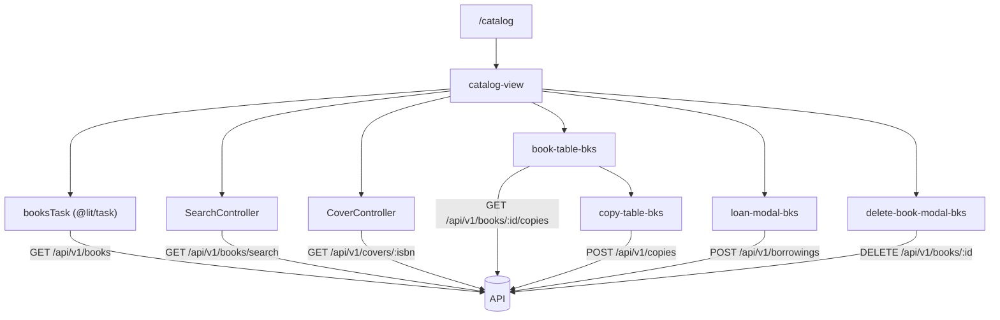

<!-- map: front | sha: 239e023 | sources: web/src/**, web/index.html, web/vite.config.js -->

# Map — Front end

<!-- Generated by /map. Never hand-edit: the next run overwrites everything
     except the Why column, which is carried over verbatim for unchanged
     components. -->

| | |
|---|---|
| **Framework** | Lit 3 web components + Vite 8, no compile step beyond the bundler (`web/package.json`) |
| **Routing** | `@vaadin/router` 2, configured in `web/src/booksnap-app.js:77-138`, rendering into the shell's `<main>`; views are named by tag string and loaded with a dynamic `import()` after the guard passes |
| **State** | No state library. Views own their reactive properties / `@state()` and pass them down; `@lit/task` loads the paginated lists; two Lit ReactiveControllers (`web/src/controllers/`); one module-level store (`web/src/auth-state.js`) |
| **Data fetching** | Plain `fetch` behind `apiFetch` (`web/src/api/http.js`) — session cookie plus CSRF header on writes; per-domain modules in `web/src/api/*.js` build URLs from `web/src/api/api-routes.js`. Calls are same-origin by default and Vite proxies `/api` to `http://127.0.0.1:8080` in dev (`web/vite.config.js:3-14`) |
| **Routes** | 10 |
| **Components** | 33 — 9 pages, 1 layout, 15 containers, 5 presentational, 2 hooks, 1 store |

---

## Routes

<!-- Sorted by path. The entry table: a reader starts from a URL they have
     seen, not from a component name. -->

| Route | Page component | Guard | Loads | Why |
|---|---|---|---|---|
| `(.*)` | — (redirect to `/`) | — | — | an unknown URL lands on the home route, whose guard then decides like any other |
| `/` | `home-view` | session | — | |
| `/account` | `account-view` | session | `POST /api/v1/auth/password` | |
| `/add` | `add-book-view` | session | `external: openlibrary.org` | the ISBN lookup is the only load, and it is not our API |
| `/analytics` | `analytics-view` | session | — | |
| `/borrowings` | `borrowing-view` | session | `GET /api/v1/borrowings`, `GET /api/v1/holds`, `GET /api/v1/covers/:isbn` | |
| `/catalog` | `catalog-view` | session | `GET /api/v1/books`, `GET /api/v1/covers/:isbn`, `GET /api/v1/copies/statuses` | |
| `/login` | `login-view` | none | `POST /api/v1/auth/login` | the one route without the session guard, and it redirects to `/` when a session already exists — which is what keeps the two redirects from chasing each other |
| `/scan` | `scan-qrcode-view` | session | `GET /api/v1/borrowings/:copyId` | the lookup runs on a decoded QR code, not on entering the route |
| `/settings` | `settings-view` | session | — | |

The guard is `_protectedRoute` (`web/src/booksnap-app.js:166-191`): it reads
`isAuthenticated()` from `web/src/auth-state.js`, remembers the destination and redirects
to `/login`. `loadSession()` runs once before `setRoutes` (`booksnap-app.js:68-77`), so no
guard decides while `GET /api/v1/auth/me` is still in flight.

---

## Components

<!-- Grouped by feature directory, sorted by path within each group. One row per
     component.

     `Kind` is a fixed vocabulary — page | layout | container | presentational |
     hook | store. Nothing else.

     `Owns state` names the state this component is the source of truth for,
     and is empty for anything that only receives props. `Calls` is this map's
     own discovery. `Used by` is transposed by the seam pass: leave it empty
     when generating. -->

### `web/src/`

| Component | Kind | Owns state | Calls | Used by | Why |
|---|---|---|---|---|---|
| `auth-state` | store | `authenticatedUser`, `sessionLoad`, `requestedDestination`, `sessionExpired` | `GET /api/v1/auth/me` | | the one `/auth/me` of a page load, memoised so whoever asks second waits for the first answer |
| `booksnap-app` | layout | `hideNavigation`, `isSessionLoading`, `_currentUser`, `_accessDeniedMessage` | `POST /api/v1/auth/logout` | | listens on `window` for `booksnap-session-expired` / `booksnap-access-denied`, which the API layer raises from a module and so cannot bubble through the DOM |

### `web/src/components/`

| Component | Kind | Owns state | Calls | Used by | Why |
|---|---|---|---|---|---|
| `button-bks` | presentational | — | — | | form-associated (`static formAssociated = true`), so a `type="submit"` instance submits through `ElementInternals` |
| `dropdown-bks` | presentational | — | — | | emits `dropdown-selected-option` with `{action, data}`; the view switches on it |
| `info-modal-bks` | presentational | — | — | | deliberately actionless: it reports a refusal the user cannot lift from this screen |
| `modal-bks` | presentational | — | — | | |
| `search-bar-bks` | container | `_genreQuery`, `_genreOptions`, `_genreOpen`, `_selectedGenre`, `_statuses`, `_selectedStatus` | `GET /api/v1/copies/statuses`, `GET /api/v1/genres/search` | | the status list is fetched on `connectedCallback`; the genre list only once 3 characters are typed |
| `spinner-bks` | presentational | — | — | | |

### `web/src/controllers/`

| Component | Kind | Owns state | Calls | Used by | Why |
|---|---|---|---|---|---|
| `CoverController` | hook | `urls` (isbn → objectURL \| `'loading'` \| `null`) | `GET /api/v1/covers/:isbn` | | holds object URLs, so it revokes them on `hostDisconnected` and on `invalidate(isbn)` after a cover is replaced |
| `SearchController` | hook | `query`, `genres`, `copyStatus`, `results`, `isSearching` | `GET /api/v1/books/search` | | |

### `web/src/features/book/`

| Component | Kind | Owns state | Calls | Used by | Why |
|---|---|---|---|---|---|
| `book-form-bks` | container | `isFiction`, `deweyClasses`, `deweyDivisions`, `deweyCategories`, `selectedClass`, `selectedDivision`, `selectedCategory` | `GET /api/v1/dewey/classes`, `GET /api/v1/dewey/classes/:classCode/divisions`, `GET /api/v1/dewey/divisions/:divisionCode/categories` | | the three Dewey levels are fetched one at a time, each on the previous `<select>`'s change; nothing is fetched for a fiction book |
| `book-table-bks` | container | `_bookCopies` (bookId → `{data, loading, error}`), `expandedRows`, `openActionMenuId`, `_isMobile` | `GET /api/v1/books/:id/copies` | | copies are fetched when a row is expanded and cached per book; `refreshCopies(bookId)` is the public re-read the view calls after a copy changed. The admin-only `delete-book` entry (`book-table-bks.js:411-421`) is cosmetic — `hasRole(ADMIN)` on the server is what refuses |
| `create-book-bks` | container | `_modalOpen`, `_modalType`, `_modalData`, `_sectionName`, `_bookTitle`, `_coverError` | `POST /api/v1/books`, `POST /api/v1/covers`, `POST /api/v1/copies` | | driven by its parent through `submitBook()` / `showError()` rather than by properties; a 409 from `POST /api/v1/books` turns into the "create another copy?" step, which is what issues `POST /api/v1/copies` |
| `delete-book-modal-bks` | container | — | `DELETE /api/v1/books/:id` | | a 403 closes silently because `apiFetch` already raised the shell's banner; only the 409 is re-emitted as `delete-refused` (`delete-book-modal-bks.js:65-89`) |
| `update-book-modal-bks` | container | — | `PUT /api/v1/books/:id` | | |

### `web/src/features/borrowing/`

| Component | Kind | Owns state | Calls | Used by | Why |
|---|---|---|---|---|---|
| `loan-modal-bks` | container | `_step`, `_query`, `_students`, `_selectedStudent`, `_error`, `_conflict` | `GET /api/v1/users/search`, `POST /api/v1/borrowings` | | a `hold` property skips the student search: only the student the copy is held for may collect it, and that loan fulfils the hold. A 409 means the copy was taken between the availability check and the confirmation, so it switches to the "no longer available" step and emits `copy-unavailable` for the parent to re-read |
| `return-modal-bks` | container | `_step`, `_copyStatus`, `_error` | `POST /api/v1/borrowings/:id/return` | | a 409 (somebody checked the loan in first) still emits `borrowing-returned`, so the caller refreshes its stale list |

### `web/src/features/copy/`

| Component | Kind | Owns state | Calls | Used by | Why |
|---|---|---|---|---|---|
| `copy-qr-modal-bks` | container | `_qrCode` | `GET /api/v1/copies/:id/qrcode` | | the PNG is read as base64 and inlined in a `data:` URL so `window.print()` has the image already |
| `copy-section-modal-bks` | container | `_sectionName`, `_error` | `PUT /api/v1/copies/:id` | | |
| `copy-table-bks` | container | `openActionMenuId`, `_isMobile`, `error` (on a failed create) | `POST /api/v1/copies` | | the row menu is built from the copy's status, so the entries differ per row; `hold-book` appears only when no copy of the book is available. The admin-only `delete-copy` entry (`copy-table-bks.js:277-287`) is cosmetic |
| `delete-copy-modal-bks` | container | — | `DELETE /api/v1/copies/:id` | | same split as the book modal: 403 closes silently, 409 becomes `delete-refused` (`delete-copy-modal-bks.js:61-85`) |

### `web/src/features/cover/`

| Component | Kind | Owns state | Calls | Used by | Why |
|---|---|---|---|---|---|
| `cover-upload-bks` | container | `_previewUrl`, `_file`, `isLoading` | — | | holds the picked `File` and exposes `getCover()` / `hasNewCover()` / `reset()`; the upload itself is done by whoever submits the form. `hasNewCover()` is what distinguishes "replace the cover" from "leave the stored one alone" |

### `web/src/features/hold/`

| Component | Kind | Owns state | Calls | Used by | Why |
|---|---|---|---|---|---|
| `hold-modal-bks` | container | `_step`, `_query`, `_students`, `_selectedStudent`, `_queuePosition`, `_error` | `GET /api/v1/users/search`, `POST /api/v1/holds` | | a 409 is shown in place as "this student already has an active hold", with nothing to retry |

### `web/src/features/scanner/`

| Component | Kind | Owns state | Calls | Used by | Why |
|---|---|---|---|---|---|
| `barcode-scanner-bks` | container | `result`, `hideVideo`, `isScanning`, `videoStream` | — | | owns the camera stream and a ZXing reader; emits `sendBarcode` with `{code, type}` and stops itself on the first decode |

### `web/src/utils/`

<!-- Pure helper modules, not components: `Kind` is `—` for every row and they
     have no lifecycle, no state and no API of their own. -->

| Component | Kind | Owns state | Calls | Used by | Why |
|---|---|---|---|---|---|
| `bookFormatter` | — | — | — | | |
| `bookMapper` | — | — | — | | maps a stored book back into the OpenLibrary shape `book-form-bks` reads, which is why the update modal can reuse the create form |
| `dateFormatter` | — | — | — | | parses `2023-10-12` field by field: `new Date('2023-10-12')` is UTC and shifts the day west of Greenwich |
| `formDataMapper` | — | — | — | | |
| `statusFormatter` | — | — | — | | |

### `web/src/views/`

| Component | Kind | Owns state | Calls | Used by | Why |
|---|---|---|---|---|---|
| `account-view` | page | `isSubmitting`, `errorMessage`, `successMessage` | `POST /api/v1/auth/password` | | the confirmation field is compared here and never sent — the server has nothing to compare it against |
| `add-book-view` | page | `activeTab`, `book`, `isbn`, `isFetching`, `showBookForm`, `showNotFound`, `_scannerLoaded` | `external: openlibrary.org` | | submits through `create-book-bks.submitBook()`, so the book and cover writes belong to that component; the scanner is a dynamic `import()` because it pulls in the whole ZXing library |
| `analytics-view` | page | — | — | | placeholder: a single heading |
| `borrowing-view` | page | `_mode`, `_query`, `_committedQuery`, `_status`, `_openActionMenuId`, `_borrowingToReturn`, `_holdToHandOver`, `_isMobile`, `page`, `size` | `GET /api/v1/borrowings`, `GET /api/v1/holds` | | one `@lit/task` for both lists, so switching tab does not fetch the list being left; handing a hold over reuses `loan-modal-bks` rather than a modal of its own |
| `catalog-view` | page | `page`, `size`, `bookToDelete`, `bookToUpdate`, `qrCopy`, `copyToUpdate`, `copyToDelete`, `copyToBorrow`, `borrowingToReturn`, `bookToHold`, `showCreateModal`, `updateError`, `deleteRefusal` | `GET /api/v1/books`, `GET /api/v1/borrowings/:copyId`, `PUT /api/v1/books/:id`, `POST /api/v1/covers` | | it re-reads `GET /api/v1/borrowings/:copyId` before opening the loan or return modal because the rendered row can be stale — another librarian may have lent the copy since (`catalog-view.js:520-546`, `577-599`). A refused delete is turned into `info-modal-bks` from the same handler that dismisses the confirmation, so only one `modal-bks` is ever on screen (`catalog-view.js:105-112`). An update that changed the ISBN invalidates both cover keys |
| `home-view` | page | — | — | | the only view statically imported by the shell |
| `login-view` | page | `isSubmitting`, `errorMessage`, `noticeMessage` | `POST /api/v1/auth/login` | | `error.status` separates a refused sign-in (401) from an unreachable server (no status); the password is read into a local and never assigned to a property |
| `scan-qrcode-view` | page | `_scannedCode`, `_copyId`, `_copyToLend`, `_borrowingToReturn` | `GET /api/v1/borrowings/:copyId` | | one lookup decides the branch: a copy that is out opens the return modal, an available or held copy opens the loan modal |
| `settings-view` | page | — | — | | placeholder: a single heading |

---

## Shared state

<!-- Stores, contexts and global hooks: what holds state that outlives a single
     component. `Written by` and `Read by` are transposed by the seam pass.
     Omit the section if this project has none. -->

| Store | Shape | Persisted | Written by | Read by | Why |
|---|---|---|---|---|---|
| `auth-state` | `authenticatedUser: {id, firstName, lastName, email, role} \| null`, `sessionLoad: Promise \| null`, `requestedDestination: string \| null`, `sessionExpired: boolean` | no — the session cookie is the state; there is no `localStorage` or `sessionStorage` anywhere in `web/src` | | | not a security boundary: it says what the front end believes, so the interface can be built accordingly, and `SecurityConfig` decides what the API accepts. `isAdmin()` only hides menu entries |

---

## Data flow

<!-- The one diagram for this map: route → page → the components that own state
     → the endpoints hit, for the project's central route only. Capped at ~15
     nodes. Never the component tree — a 200-node graph is unreadable and its
     diff is noise. -->

---

## Gaps

<!-- Dynamic rendering, components reached only through a registry or a string
     key, anything behind a feature flag — the places where `Used by` cannot be
     trusted. Say so here rather than letting an empty cell mislead. -->

- **Every component is reached by tag name, not by the identifier it exports.**
  `customElements.define(...)` plus a side-effect `import './x.js'` and a `<x-bks>` tag in
  a template is the whole wiring. An import-graph transpose sees the side-effect import,
  which is usually enough — but the tag and the import are two independent facts, and a
  module that drops one keeps working as long as something else imported the file.
- **The router names views as strings.** `booksnap-app.js:77-138` passes
  `component: 'catalog-view'` with the module behind a `() => import(...)`. Eight of the
  nine views have no static import anywhere; only `home-view` is imported eagerly
  (`booksnap-app.js:16`). A transpose over static imports will therefore show the views
  as used by nothing, and `Used by` for them must be read as "the router".
- **`barcode-scanner-bks` is also loaded dynamically**, from `add-book-view.js:44-47`, and
  statically from `scan-qrcode-view.js:5`. The first of those is invisible to a static
  import graph.
- **`spinner-bks` is used without a local import** in `copy-qr-modal-bks.js:52`. It renders
  only because some other module on the page registered the element first — a real
  ordering dependency a `Used by` column cannot express.
- **`update-book-modal-bks` is registered and imports nothing of itself aside from
  `book-form-bks`, and no other module references its file or its tag.** `catalog-view`
  inlines its own update dialog instead (`catalog-view.js:132-168`). Recorded as it is; the
  `Unreferenced` section is omitted because the transpose that would confirm this has not
  run.
- **`GET /api/v1/auth/csrf` appears in no `Calls` cell.** `apiFetch` issues it itself
  (`http.js:67-76`) before the first non-safe method of a browser session, so it belongs to
  no component.
- **A cover upload can also reach `external: openlibrary.org`.** `cover.js:48` plain-fetches
  the image bytes when the cover is supplied as a URL string, which is the case for a book
  scanned from Open Library. The host comes from the data rather than from the code, so the
  call is not attributed to a component.
- **`web/src/api/*.js` and `web/src/utils/*.js` are not components.** The API modules are
  deliberately absent from the tables — they are the indirection the `Calls` column
  resolves through. The utils are listed with `Kind` `—` so that a reader looking for
  `formatDate` finds where it lives.
- **The working tree is not `HEAD`.** This map describes the uncommitted state of the
  book/copy soft-delete work in `book-table-bks`, `delete-book-modal-bks`, `copy-table-bks`,
  `delete-copy-modal-bks`, `catalog-view`, `api/book.js`, `api/copy.js` and `auth-state.js`;
  the `sha` on line 1 is the commit those changes sit on top of.
- No cell was left `?`: every component, route and call resolved to a concrete file and a
  concrete path.
